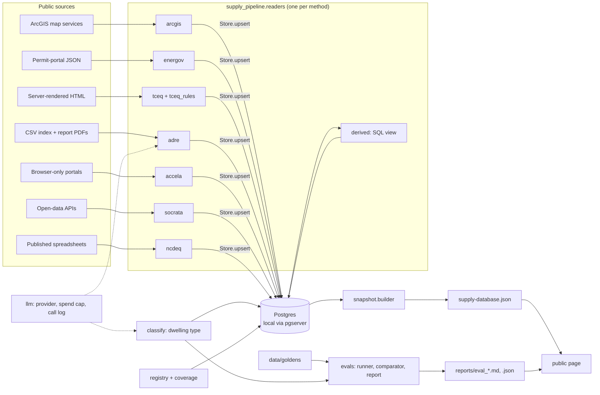

# supply-pipeline

Readers that collect housing-supply filings (permits, plats, rezonings, stormwater notices) from public sources, a Postgres store, the builder that turns the store into the public supply page's JSON, and the evaluation of the model that labels each filing's product type.

**Live:** [hermanchan.ai/supply-database](https://www.hermanchan.ai/supply-database/). The dashboard renders this builder's output, and the Phoenix row of the evaluation table under "How I check it" is what this repo's eval report reproduces.

## Why it exists

Underwriting a rental or build-to-rent deal means knowing what else is coming: how many apartments, townhomes and single-family lots are filed, approved or under construction nearby, and how early you can see them. No single source has that. It is spread across county map services, permit portals, state stormwater programs and planning agendas, each with its own format, so the pipeline reads 254 feeds in nine metros and keeps track of how each one is collected and how fresh it is.

## Architecture



Production runs these readers against a hosted Postgres, most of them on a weekly schedule. This repo swaps that for a `Store` interface backed by a local Postgres that `pgserver` downloads as a pip package, so the SQL (upserts, the derived view, the builder's queries) runs unchanged with nothing to install or configure.

## Quickstart

Runs offline on the bundled sample (Python 3.11 or 3.12):

```bash
python -m venv .venv && . .venv/bin/activate && pip install -r requirements-dev.txt
python -m supply_pipeline.snapshot --sample sample --out build/supply-database.json
python -m supply_pipeline.evals.run --surface azdeq_classify --replay data/recorded/azdeq_classify_haiku-4-5_2026-10-03.jsonl --out build
```

The first command writes the page's JSON from `sample/`. The second re-scores the Phoenix classifier from recorded model outputs (no API key, $0) and prints the report; it exits 1 because the run has rent/sale errors, which is the production rule.

## How it's tested

`pytest -p no:cacheprovider --disable-socket` runs 92 tests with every network socket blocked (CI does the same on Python 3.11 and 3.12, plus `ruff`). Postgres runs on a local Unix socket, which `pyproject.toml` allows.

- **Readers:** each of the eight runs against responses recorded from the real source on 2026-10-21 and trimmed (see `tests/fixtures/README.md`): paging, header-aware parsing, what happens when a page fails or the source changes shape, and what lands in the table. The browser reader's parsing is tested on a recorded results page; driving Chromium needs a live portal and is not run offline.
- **Store:** upsert rules, including that a re-sweep from a thinner source never wipes an enriched value and that coordinates only move as a pair.
- **Builder:** it refuses an untagged feed, an unknown metro or a mislabelled example; on the sample its output has the same keys as the live page's JSON at every level, the same feed counts per method and per metro, and is identical run to run.
- **Eval:** the Phoenix golden set replayed through the classifier code and scored by the report reproduces the published row: 65 filings, 84.6% exact (55), 86.2% right business bucket (56), 7 rent/sale errors. The Atlanta set replays a run recorded on the public inputs: 93 filings, 77.4% exact (72), 81.7% right bucket (76), 11 rent/sale errors (`reports/eval_epd_classify_dwelling.md`).
- **LLM recording:** a live run with `--record` writes a file that `--replay` answers from, and the run reports its real spend.
- **LLM wrapper:** an unpriced model is refused, a call over the per-call or per-run cap never fires, and every call is logged.

## Design decisions

- **One reader per method, tenants as configuration.** A Tyler EnerGov or Accela reader covers every jurisdiction on that software, so adding a city is a config entry. The cost is that a vendor-wide change breaks every tenant at once, which is why the readers fail loudly (a failed page raises, a missing header raises with the column name) instead of reading as an empty result.
- **Rules first, the model second.** The TCEQ layer decides a filing from its construction type, SIC code, apartment brands and builder rosters when that evidence is there, and only sends the rest to a model. It is cheaper and auditable, but every roster is a list someone maintains, and each guard in `tceq_rules.py` names the false positive it was added for.
- **Errors are scored by business impact, not just accuracy.** Single-family versus townhome is cosmetic (both are for-sale); for-sale versus rental is the error that distorts a rent underwrite, and any one of them fails the run. A run can therefore score 84.6% and still exit 1.
- **Replay instead of re-running the model.** Recorded outputs are keyed by a hash of the exact prompt input, so a re-score is free and cannot drift: if the input changes, the replay misses and the test fails. The trade-off is that a replay proves the scoring code, not the model's current behaviour.
- **Coverage is frozen, not rebuilt.** A clone cannot re-collect 441,000 records, so `sample/` freezes the registry and per-feed counts and bundles a slice of real rows per example feed. The output has the page's shape and feed counts; its record counts are those of the freeze date, not the page's.

## What's not in this repo and why

- **The production database and the 441,243 records counted on the page.** Only the registry, per-feed counts, the multifamily layer and small slices of public-record rows are bundled (`sample/README.md`).
- **The 246 other feeds' readers**, the weekly scheduler, deploy configuration and hosting. The eight here are the page's example feed for each method.
- **People's contact details.** Applicant and reviewer names, emails, phones and mailing addresses are never read into a row; the Nashville caption's applicant/owner clause is redacted; owner names, emails and notes are dropped from the Atlanta goldens.
- **Atlanta's production inputs.** Production's Atlanta classifier also reads owner names and email domains, which the public goldens cannot carry. It scored 82.8% exact with them; on the public inputs it scores 77.4%, and that is the number this repo reproduces (`data/README.md`).
- **Data licensed from commercial vendors.** None is used by these readers or bundled.
- **The model-cost table on the page.** It comes from production's call log; the wrapper here writes the same kind of log locally (`data/local/llm_calls.jsonl`).

---

© 2026 Herman Chan. Published for portfolio review; no license is granted.
